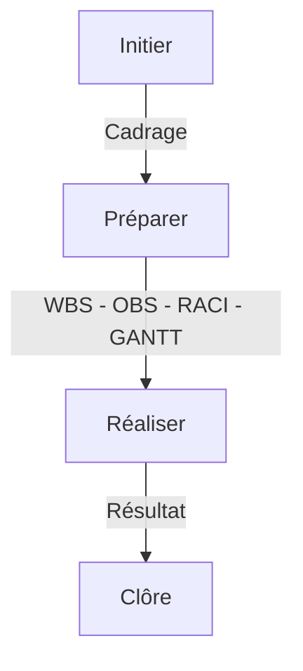
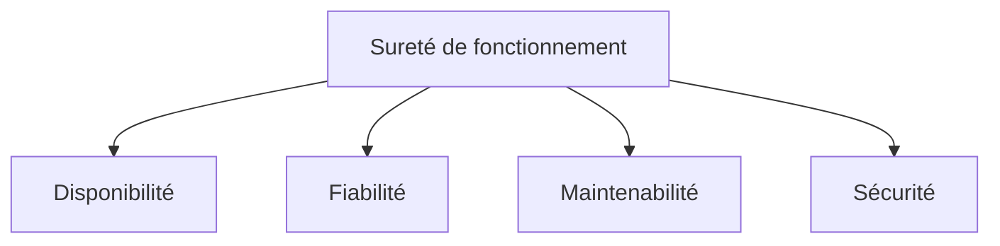
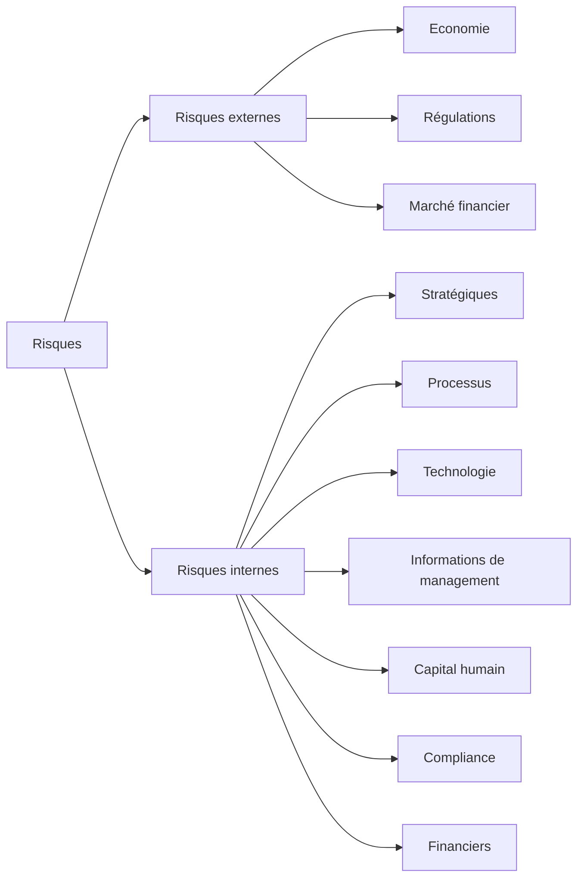

# Note analyse de risques

# Analyse des risques

## Étapes de gestion de projet

## Étapes de l'analyse des risques

1. **Identification des risques** : cette étape consiste à identifier les risques potentiels associés à un projet ou à une activité. Cette étape peut être effectuée en utilisant des outils tels que des check-lists, des revues de documentation ou des interviews avec des parties prenantes.
2. **Évaluation des risques** : cette étape consiste à évaluer la gravité et la probabilité de chaque risque identifié. Les évaluations peuvent être effectuées en utilisant des échelles de notation ou des matrices de risques. Cette étape permet de classer les risques par ordre d'importance et de prioriser les actions pour les traiter.
3. **Analyse des causes** : cette étape consiste à identifier les causes sous-jacentes des risques identifiés. Cela peut impliquer une analyse des processus, des systèmes, des procédures ou des comportements qui ont contribué à la création des risques.
4. **Développement de mesures d'atténuation** : cette étape consiste à élaborer des mesures d'atténuation pour chaque risque identifié. Ces mesures peuvent inclure des actions préventives, des plans d'urgence ou des plans de continuité d'activité.
5. **Mise en œuvre des mesures d'atténuation** : cette étape consiste à mettre en œuvre les mesures d'atténuation identifiées pour réduire ou éliminer les risques identifiés.
6. **Suivi et évaluation des mesures d'atténuation** : cette étape consiste à surveiller l'efficacité des mesures d'atténuation mises en place pour s'assurer qu'elles sont efficaces pour réduire les risques. Si nécessaire, des ajustements peuvent être apportés pour améliorer l'efficacité des mesures d'atténuation.

## Sureté de fonctionnement (SdF)

### Identification des risques

### AMDEC

Plusieurs étapes :

1. Définition des tâches
2. Causes
3. Effets
4. Effets

| Valeur | Qualité | Délai | Coûts |
| --- | --- | --- | --- |
| 1 | Léger défaut | Léger retard | Léger dépassement < 10% |
| 2 | Exigences pas respectées |  | > 10% / 30% |
| 3 | Écarts / défauts |  | 30% / 50% |
| 4 | Écarts / Problème majeur | Dépassement de la date limite | 30% / 50% |

1. Criticité

| Valeur | Gravité | Fréquence | Non-détectabilité |
| --- | --- | --- | --- |
| 1 | Défaillance mineure | Faible | Visible tout de suite |
| 2 | Défaillance provoquant une gêne pour l'utilisateur | Fréquente | Difficile à détecter |
| 3 | Défaut provoquant un rébus | Élevée | Le défaut n'est pas détectable |
| 4 | Risque d'accident | Arrive souvent | Risque certain |

> Criticité = Gravité × Occurrence × Détection

# Workshop

## Spécification

**Terrain** :

- Vous avez besoin d'un terrain d'une surface minimale de 500m2 qui est situé à moins de 10 km de votre lieu de travail.
- Le terrain doit être conforme aux normes de construction locales et doit avoir un accès facile aux services publics tels que l'eau et l'électricité.

**Maison** :

- Vous avez besoin d'une maison d'une surface minimale de 120m2 qui a 4 chambres et 2 salles de bains.
- La conception de la maison doit être adaptée à votre style de vie et à vos besoins, en consultation avec votre architecte.
- La maison doit être construite avec des matériaux durables et respectueux de l'environnement.

**Jardin** :

- Vous souhaitez avoir un jardin d'une surface minimale de 10m2 qui est fertile et prêt à être cultivé.
- Le jardin doit avoir un accès facile à l'eau et à la lumière du soleil.

**Budget** :

- Le coût total du projet ne doit pas dépasser votre budget disponible de 100 000 euros.

**Planning** :

- La construction doit être terminée dans les deux ans à compter de l'achat du terrain.
- Le travail de construction doit être effectué de manière efficace et en temps voulu, en consultation avec votre architecte et vos entrepreneurs.

**Sécurité** :

- La sécurité des travailleurs et des visiteurs doit être prise en compte tout au long du projet de construction.
- Des mesures de sécurité doivent être en place pour protéger le site de construction contre le vol et les intrusions.

**Respect de l'environnement** :

- Les matériaux de construction doivent être respectueux de l'environnement et durables.
- La conception de la maison doit inclure des mesures d'efficacité énergétique pour réduire la consommation d'énergie.
- Des mesures doivent être prises pour minimiser les déchets de construction et les émissions de carbone tout au long du projet.

## Analyse de risques préliminaire

### Travaux

- Retards : incompétence / surcharge
- Pénurie de matériaux
- Coût de matériaux
- Mauvaise estimation
- Partenaires / Prestataires / Architectes : Pas motivé, pas performants, pas disponibles.

### Financiers

- Refus de prêts
- Hausse des taux
- Baisse de l'épargne
- Hausse de la valeur du marché

### Techniques

- Pénurie de matériaux

### Familial

- Décès
- Mutation
- Chommage

### Environnementaux

- Mouvements sociaux / blocages
- Pandémie
- Catastrophe naturelle
- Guerre

### AMDEC

| Étape | Description | Modes de défaillance | Effets potentiels | Détectabilité | Gravité | Fréquence | Criticité | Actions préventives | Actions correctives |
| --- | --- | --- | --- | --- | --- | --- | --- | --- | --- | --- |
| 1 | Recherche de terrain | Terrain inadapté aux spécifications | Coûts supplémentaires, retards | Haute | 3 | 2 | 6 | Revoir les spécifications, effectuer une analyse de faisabilité avant l'achat | Trouver un nouveau terrain, réévaluer le budget |
| 2 | Conception de la maison | Erreurs de conception, matériaux inadéquats | Défauts de construction, coûts supplémentaires, dangers potentiels | Moyenne | 4 | 3 | 12 | Travailler avec un architecte qualifié, sélectionner des matériaux de qualité | Réparer les défauts de construction, revoir le design |
| 3 | Construction de la maison | Retards, erreurs de construction | Coûts supplémentaires, retards, dangers potentiels | Moyenne | 4 | 3 | 12 | Surveiller régulièrement le travail des entrepreneurs, faire des inspections régulières | Réparer les erreurs de construction, mettre en place un calendrier de travail plus serré |
| 4 | Sécurité du chantier | Accidents, vols | Dommages matériels, blessures, retards | Haute | 5 | 2 | 10 | Formation régulière des travailleurs sur les mesures de sécurité, embauche de gardes de sécurité | Renforcer la sécurité du chantier, mettre en place des mesures de surveillance supplémentaires |
| 5 | Respect de l'environnement | Émissions de carbone, déchets de construction, non-respect des normes environnementales | Impacts environnementaux négatifs, coûts supplémentaires, retards | Moyenne | 3 | 2 | 6 | Planifier des mesures pour minimiser les déchets de construction, sélectionner des matériaux écologiques | Mettre en place des mesures correctives pour minimiser les émissions de carbone, effectuer une analyse environnementale approfondie |