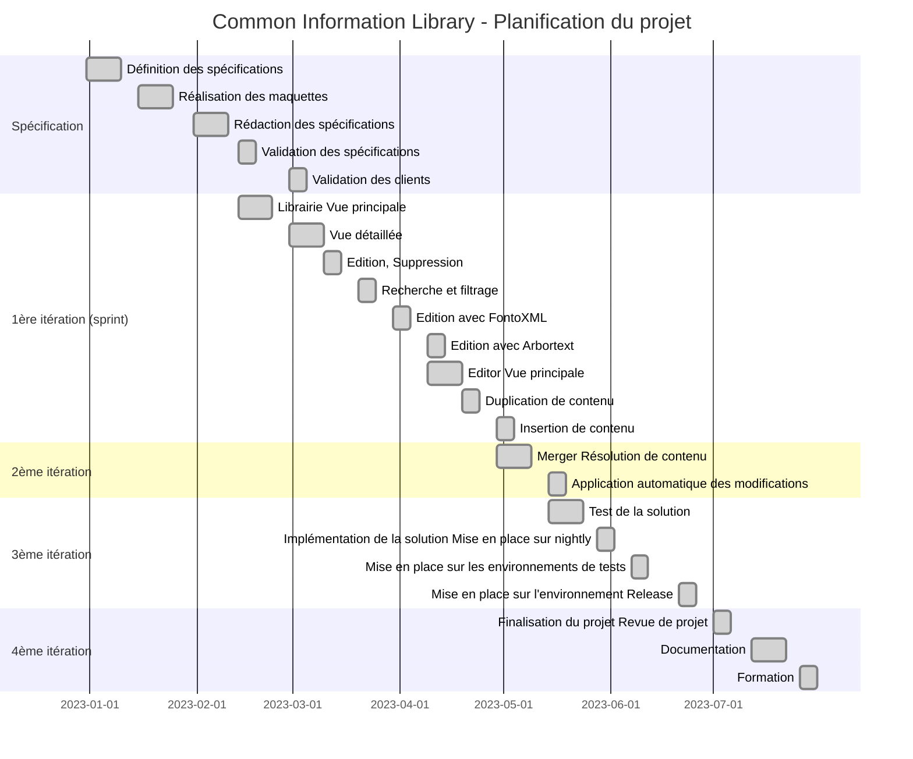

Requirements

- Media Library : cgm, xls xslx, pdf, wrl
- Module Library
- Read-only : previous data module releases
- Declare new fleet with the s1000d
- Filtres
- Sync entre CIR et Manuels (manuels doivent être notifié si changement)

## Notes

### Problèmes

- Vue de l'application en 80% - 100% sur écran de PC

## Modèle de données

```json
_id: ObjectId;key: String;revNumber: Number;operatorCode: String;fileId: String;filename: String;type: String;metadata : {    label: String;    creationDate: Date;    updatedAt: Date;}
```

## Format de la donnée

```json
<!ENTITY C.CO22 "<PARA> text </PARA>"><!ENTITY C.CO22 "<PARA><REVST><REVEND></PARA>"><!ENTITY C.CO22 "<PARA><UNLIST><UNITEM><UNITEM></UNLIST></PARA>">
```

## Maquette

Maquette d'interface CIL.

