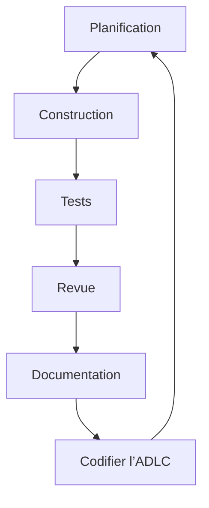

### Contexte
L'IA génère désormais la majorité du nouveau code, mais cela entraîne une surcharge de code et des problèmes de qualité. La différence entre les équipes qui réussissent et celles qui sombrent réside dans le passage de l'écriture de code à l'**orchestration** des agents IA.

## Les quatre pratiques fondamentales

1. **Ingénierie du contexte synchronisée**  
   - Curation systématique des informations projet (diagrammes, standards, règles métier) dans la mémoire de travail de l'IA.  
   - Passe du prompt engineering au contexte engineering ; la qualité de la sortie dépend du contexte fourni.  
   - Utilisation de fichiers comme `CLAUDE.md` et du standard MCP (Anthropic) comme couche de connaissance persistante.

2. **Développement piloté par les spécifications**  
   - La qualité du code généré reflète la qualité des spécifications d'entrée.  
   - Définir clairement ce que l'on veut avant de demander à l'IA, décomposer en jalons avec critères de succès, valider à chaque étape.

3. **Vérification critique**  
   - Le code IA ressemble à celui d'un junior : ~45 % contient des défauts de sécurité.  
   - La vérification (revue, tests, analyse statique) devient le facteur limitant, pas la génération.  
   - Nécessite des boucles serrées humain‑dans‑la‑boucle avec validation fréquente.

4. **Décomposition du problème**  
   - Éviter de confier à l'IA des problèmes trop grands ; découper en morceaux gérables où l'IA gère le routine et l'humain les cas particuliers.  
   - Réduit la pollution de contexte et la génération de "slop".

### Répartition du temps recommandée
- 40 % : mise en place du contexte  
- 20 % : génération et itération de test  
- 40 % : revue et vérification  

## Parcours de transformation individuelle

| Phase | Durée | Objectifs principaux |
|-------|-------|----------------------|
| Fondation | Quelques semaines | Choisir un assistant IA (Codex, Claude Code, Cursor), établir un workspace, développer le jugement sur l'utilité de l'IA. |
| Integration | Jusqu'à un mois | Adopter des frameworks de prompting structurés, créer des fichiers de contexte projet, mettre en place le workflow *Plan → Execute → Review* avec portes de validation. |
| Maîtrise | Continu | Utiliser l'IA pour des tâches multi‑étapes, mettre en place des revues de code assistées, expérimenter avec des workflows multi‑agents, viser ≥80 % de code généré par IA avec <20 % de réécriture. |

## Transformation d’équipe – fondements culturels

1. **Sécurité psychologique** – célébrer les échecs IA comme des opportunités d’apprentissage (MIT : 83 % des dirigeants y voient un impact positif).  
2. **Révision de code évoluée** – séparer la revue du code généré IA du code humain, éviter les PR où IA génère et IA révise simultanément.  
3. **Bibliothèques de contexte partagées** – standardiser fichiers de contexte, jeux d’évaluation, configurations d’agents entre les équipes.

## Cycle de développement agentic (ADLC)

- **Planification** : recherche approfondie, spécification, décomposition, création de roadmap avec agents parallèles.  
- **Construction** : agents implémentent les fonctionnalités ; l’ingénieur orchestre tel un tech‑lead.  
- **Tests** : TDD réinventé – agents écrivent les tests d’abord, puis le code, validation incrémentale.  
- **Revue** : essaims d’agents spécialisés (fonctionnalité, qualité, sécurité, performance…) produisent des rapports revus par les humains.  
- **Documentation** : génération continue (sommaires, diagrammes, changelogs) intégrée en temps réel.  
- **Codifier l’ADLC** : encapsuler les pratiques dans des fichiers de contexte, des bibliothèques de compétences, des outils MCP pour une adoption organisationnelle.

## Garde‑rails de sécurité (non optionnels)

- **Identité et contrôle d’accès** : authentification forte, principe du moindre privilège, commencer en lecture‑seule.  
- **Classification des données** : les agents doivent respecter les niveaux de sensibilité.  
- **Protection contre l’injection de prompt** : filtrage des entrées, validation du contenu, aucune exécution automatique de commandes non fiables.  
- **Bac à sable d’infrastructure** : observer et auditer les actions des agents, bloquer les surfaces de production à risque jusqu’à validation.  
- **Analyse statique intégrée** : détecter les faiblesses (~30 % Python, 25 % JS) dans le pipeline CI/CD, revue humaine obligatoire pour les fonctions critiques.  
- **Portes de qualité automatisées** : boucles de vérification (Ralph Loops, OpenClaw) incluant linting, type checking, tests avant soumission.  
- **Compétences en sécurité** : enseigner aux agents des modèles de codage sécurisé, détection précoce des vulnérabilités.  
- **Prévention de l’atrophie des compétences** : évaluations périodiques sans IA, conserver les fondamentaux.  
- **Paradoxe de productivité** : mesurer le temps de cycle global et la vélocité des fonctionnalités, pas uniquement la vitesse de génération.

## L’ingénieur de 2026 et au-delà

- L’IA est un partenaire d’exécution ; l’ingénieur garde la pensée critique, le jugement, la communication et l’expertise métier.  
- L’expertise domaine reste le différenciateur ; investir dans ses compétences spécialisées (math, finance, santé, droit…) renforce l’efficacité de l’IA.  
- La transformation est pluriannuelle : traiter l’IA‑native comme une nouvelle façon de travailler, pas comme une simple mise à jour d’outils.
