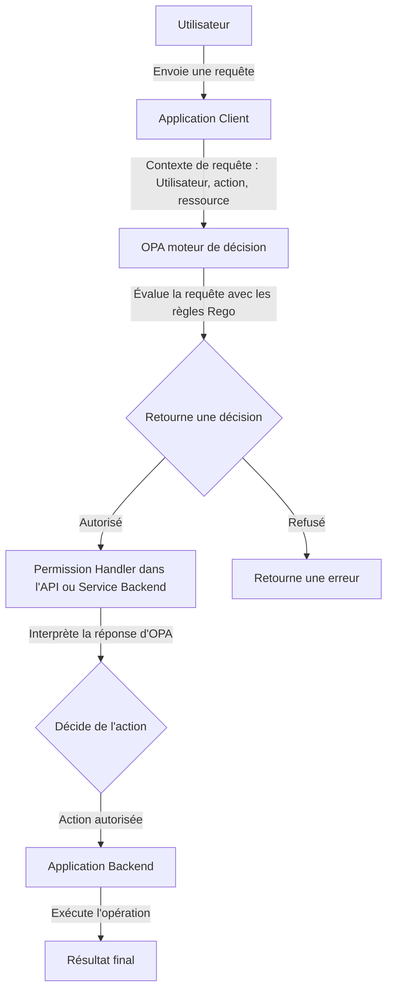

# Open Policy Agent (OPA) et Permission Handler

## Fonctionnement général

OPA est une solution de gestion des politiques centralisée qui sépare la logique d'autorisation du code de l'application. Cela garantit une gestion des permissions cohérente et centralisée.

### Étapes principales

1. **Application Client** :
   - Envoie une requête à OPA avec le contexte (utilisateur, action, ressource, etc.).
2. **OPA (moteur de décision)** :
   - Analyse la requête selon les règles définies en **Rego**.
   - Retourne une décision (ex. : autorisé/refusé).
3. **Permission Handler** :
   - Interprète la décision d'OPA dans l'application.
   - Détermine si l'action doit être exécutée ou refusée.
4. **Application Backend** :
   - Exécute l'action autorisée ou retourne une erreur.

---

## Schéma d'intégration



---

## Exemple concret

### 1. Requête utilisateur

Alice veut supprimer un document.

### 2. Contexte envoyé à OPA

```json
{
  "user": "Alice",
  "action": "delete",
  "resource": "document123"
}
```

### 3. Règle Rego

```
allow {
    input.user == "Alice"
    input.action == "delete"
    input.resource.startswith("document")
}
```

### 4. Decision d'OPA

```json
{
  "allow": true
}
```

### 5. Permission Handler

- Interprète la décision et permet à l'API de procéder.

### 6. Backend

- Supprime le document si l'autorisation est accordée.

---

## Points forts d'OPA

- Centralisation des politiques d'autorisation.
- Séparation claire entre le code applicatif et les règles.
- Gestion simplifiée des permissions dans des environnements complexes.