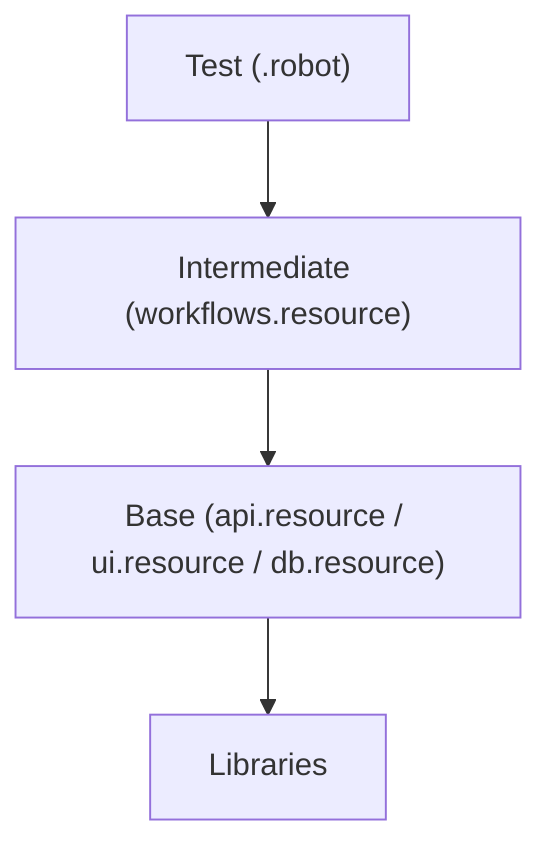
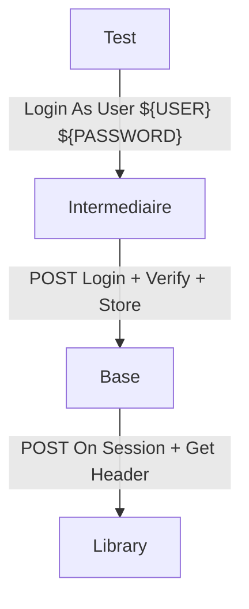

## Principe

Decoupage strict en 3 couches plus libraries pour separer les responsabilites et isoler les changements techniques.

| Couche | Fichier | Public cible | Question repondue |
|--------|---------|--------------|-------------------|
| Test | `.robot` | PO et Testeurs | "Que fait ce scenario ?" |
| Intermediaire | `workflows.resource` | Developpeurs | "Dans quel ordre et avec quelle logique ?" |
| Base | `api.resource` / `ui.resource` / `db.resource` | Developpeurs techniques | "Comment techniquement ?" |

**Regle absolue** : Chaque couche ne connait que la couche directement inferieure.



## Regles par couche

### Couche Test (.robot)

- Keywords intermediaires uniquement
- Variables dans `*** Variables ***`
- Lisible par un non-developpeur
- Pas d'appels directs aux libraries
- Pas de logique technique (boucles, conditions)
- Pas de termes techniques dans les noms (selenium, HTTP, scroll, wait)

### Couche Intermediaire (workflows.resource)

- Reception parametres via `[Arguments]`
- Orchestration des keywords Base
- Logique de sequencement (etape 1 vers etape 2 vers verification)
- Pas d'appels directs aux libraries
- Pas de credentials en dur
- Pas de locators ou URLs bruts

### Couche Base (api.resource / ui.resource / db.resource)

- Appels directs aux libraries
- Operations techniques atomiques
- Retour de valeurs brutes via `[Return]`
- Pas de logique de sequencement metier
- Pas de connaissance du scenario

### Libraries

- Importees uniquement dans couche Base
- Jamais appelees depuis Test ou Intermediaire

## Exemples complets

### Exemple 1: Login API (comme précédemment)

### Base - `resources/pages/api.resource`

```robot
*** Settings ***
Library    RequestsLibrary
Library    Collections

*** Variables ***
${LOGIN_ENDPOINT}    https://api.example.com/login

*** Keywords ***
POST Login Request
    [Arguments]    ${username}    ${password}
    ${payload}=    Create Dictionary
    ...    username=${username}
    ...    password=${password}
    ...    origin=web
    ${response}=    POST On Session    session    ${LOGIN_ENDPOINT}    json=${payload}
    [Return]    ${response}

Store Auth Token
    [Arguments]    ${response}
    ${token}=    Get Header    ${response}    x-auth-token
    Set Suite Variable    ${TOKEN}    ${token}

Verify Login Success
    [Arguments]    ${response}
    Should Be Equal As Numbers    ${response.status_code}    200
    Should Not Be Empty    ${response.headers['x-auth-token']}
```

### Intermediaire - `resources/workflows/login_workflows.resource`

```robot
*** Settings ***
Resource    ../pages/api.resource

*** Keywords ***
Login As User
    [Arguments]    ${username}    ${password}
    ${response}=    POST Login Request    ${username}    ${password}
    Verify Login Success    ${response}
    Store Auth Token    ${response}
```

### Test - `tests/feature/login_test.robot`

```robot
*** Settings ***
Resource    ../../resources/workflows/login_workflows.resource

*** Variables ***
${USER}       demo
${PASSWORD}   demo-password

*** Test Cases ***
My Scenario
    Login As User    ${USER}    ${PASSWORD}
```

## Flow d'appel



## Arborescence

```
technical-notes/
├── tests/
│   ├── feature/
│   │   └── login_test.robot              <- Couche Test
│   └── ui/
│       └── logout_test.robot             <- Couche Test (UI)
└── resources/
    ├── workflows/
    │   ├── login_workflows.resource      <- Couche Intermediaire
    │   └── ui_workflows.resource         <- Couche Intermediaire (UI)
    └── pages/
        ├── api.resource                  <- Couche Base (API)
        ├── ui.resource                   <- Couche Base (UI)
        └── db.resource                   <- Couche Base (DB)
```

## Checklist de validation

### Pour un fichier .robot (Couche Test)

- [ ] Aucun appel direct a une library
- [ ] Aucune logique technique
- [ ] Noms en langage metier
- [ ] Import uniquement depuis `resources/workflows/`

### Pour un fichier workflows.resource (Couche Intermediaire)

- [ ] Aucun appel direct a une library
- [ ] Contient des `[Arguments]`
- [ ] Import uniquement depuis `resources/pages/`

### Pour un fichier pages/*.resource (Couche Base)

- [ ] Import des libraries necessaires
- [ ] Keywords atomiques techniques
- [ ] Retour de valeurs brutes

## Pour aller plus loin

- [RobotFramework](/test/robotframework) - Syntaxe et installation
- [RobotFramework-BestPractices](/test/robotframework-bestpractices) - Bonnes pratiques
